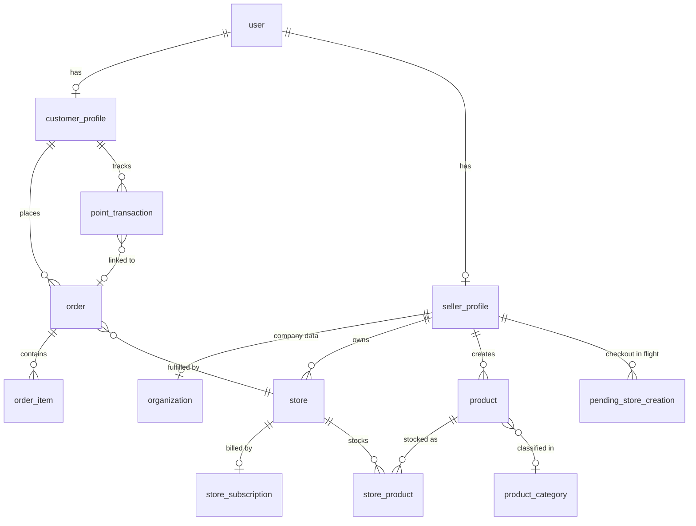

# Architecture

Cross-app overview of the **bibs** monorepo. For setup see the [root README](../README.md);
for project rules and conventions see [AGENTS.md](../AGENTS.md); for the Stripe billing
flow see [stripe-billing.md](stripe-billing.md) and, for every payment flow with examples,
[pagamenti.md](pagamenti.md).

## The monorepo at a glance

Bun workspaces. One backend, three frontends, two shared packages:

| Workspace | What it is | Port |
|---|---|---|
| `apps/api` | Hono + Bun + Drizzle + PostgreSQL/PostGIS backend | 3000 |
| `apps/customer` | Customer-facing app (TanStack Start + React 19) | 3001 |
| `apps/seller` | Seller back-office (TanStack Start + React 19) | 3002 |
| `apps/admin` | Admin back-office (TanStack Start + React 19) | 3003 |
| `packages/ui` | `@bibs/ui` — shared shadcn/ui component library | — |
| `packages/emails` | `@bibs/emails` — react-email templates (preview on 3004) | — |

The defining property of the stack is **one type flow with no code generation**:

```text
Drizzle table definitions (apps/api/src/db/schemas/)
        ↓ inform
Zod schemas (apps/api/src/lib/schemas/) — validation + OpenAPI
        ↓ typed into
Hono sub-apps, one per module → exported app types (apps/api/src/types.ts)
        ↓ inferred by
`hc` clients, one per sub-app (apps/{customer,seller,admin}/src/lib/api.ts)
```

Change a response type on the server and every frontend call site updates (or breaks
loudly) at the next `bun run typecheck`. This is why the root typecheck is mandatory
after any API change.

## Backend (`apps/api`)

### Code layout

- **`src/app.ts`** — the root Hono app, with no side effects at import (tests, tools and the Hono CLI import it).
  `rootApp()` is `new Hono({ getPath: rawPath })` with the JSON `onError` and `notFound` and the global middleware;
  `app` adds `/openapi`, `/openapi/json`, `/health`, `/ready`, better-auth on `/auth/*` and every module sub-app
  from the `MODULES` table (prefix, sub-app, guards) with `app.route(prefix, subApp)`.
- **`src/index.ts`** — the server only: cron jobs, S3 bucket check, `Bun.serve({ fetch: app.fetch })`, graceful
  shutdown.
- **`src/plugins/`** — plain Hono middleware and route groups: `request-log.ts` (log line per request),
  `cors.ts` (`hono/cors`), `better-auth.ts` (`x-forwarded-for` from the socket IP, better-auth
  handler), `openapi.ts` (`/openapi`, `/openapi/json`), `health.ts` (`/health`, `/ready`), `rate-limit.ts`
  (per-route `rateLimit()`), `cron.ts` (the five jobs below).
- **`src/http/`** — the kit every route uses: `moduleApp()` (`app.ts`), `v()` (`validator.ts`), `send()` (`send.ts`),
  `doc()` and the OpenAPI generator (`openapi.ts`), the auth guards (`auth.ts`), `guard()`, `publicRoute` and
  `assertRoutes` (`routes.ts`), the error mapping (`errors.ts`), the 422 messages (`validation-message.ts`).
- **`src/lib/schemas/`** — the Zod schemas (entities, queries, bodies, response envelopes) and the constructors of
  `t.ts`; `forms/` holds the form schemas shared with the seller app (`@bibs/api/schemas`).
- **`src/modules/<module>/`** — `index.ts` (the sub-app and its exported type), `routes/`, `services/`,
  `context.ts`.

### Request lifecycle and response contract

A request goes through the root app in this order:

1. `requestLog` starts the clock (one line per request on stdout, a JSON line in `logs/app.log`);
2. `cors` answers every `OPTIONS` as a 204 preflight, and adds the CORS headers to every other response;
3. `requestId` sets `X-Request-Id` (the client's if it looks like an id, otherwise a UUID);
4. `socketIpAsForwardedFor` overwrites `x-forwarded-for` with the socket IP, so better-auth's rate limit cannot be
   dodged with a forged header;
5. `/openapi`, `/openapi/json`, `/health` and `/ready` answer here; anything else without a valid absolute URL
   (empty or invalid `Host`) is a 400;
6. `/auth/*` goes to better-auth; a module prefix goes to its sub-app, routed on the raw path (`/me/%61vatar` is a
   404) with the trailing slash tolerated;
7. inside the route: `doc()` (OpenAPI metadata only), then the validators in a fixed order — `v("param")`,
   `v("query")`, `v("json" | "form")` — then the guard, an optional `rateLimit()`, and the handler. The validators
   read the body by `Content-Type`, coerce query and params, trim body strings (except password fields), apply
   defaults, drop unknown fields at any depth, check file magic bytes and answer the first error as an Italian
   422; the guard answers 401/403. Validation therefore comes before auth: an anonymous request with a bad body
   gets the 422;
8. the handler answers with `send(c, Schema, body)`, which validates the payload against the schema listed in
   `doc()`, drops fields outside it (internal columns never leak), writes `Date` as ISO strings and turns an
   off-schema payload into a 500;
9. a thrown error reaches the `onError` of the module (or of the root): `toErrorResponse` (`src/http/errors.ts`)
   builds the envelope and logs it; a path no route matches gets the JSON 404.

Every route returns the same envelope. There are two layers of helpers in `src/lib/responses.ts` (runtime) and
`src/lib/schemas/responses.ts` (Zod schemas for `send()` and OpenAPI):

- `ok(data)` / `okPage(data, pagination)` / `okMessage(message)` (`src/lib/responses.ts`) — runtime envelope
  builders
- `okRes(schema)` / `okPageRes(schema)` / `OkMessage` / `withErrors()` / `withConflictErrors()`
  (`src/lib/schemas/responses.ts`) — schemas used by `send()` and `doc()` so the response and OpenAPI agree
- Success shape: `{ success: true, data }` or `{ success: true, data: [...], pagination: { page, limit, total } }`
  (page `limit` is capped at 100 — request more and you get a `422 VALIDATION_ERROR`)
- Error shape: `{ success: false, error: "ERROR_CODE", message }` — never built by hand

Errors flow through one place, `toErrorResponse` (`src/http/errors.ts`), called by the `onError` of the root app and
of every `moduleApp()`:

- Business errors are thrown as `ServiceError(status, message)`; the error *code* is
  derived from the status, not passed in.
- Routes declare their error surface with `withErrors()` / `withConflictErrors()`
  (`src/lib/schemas/responses.ts`) so OpenAPI stays honest.
- Postgres unique violations (`23505`) are translated to `409` globally — unique-write
  routes don't try/catch for it.
- A 422 message is `«Etichetta: regola»` built from the first Zod issue (`src/http/validation-message.ts`); the log
  carries the field and the rule, never the submitted value.

### Auth and roles

[better-auth](https://www.better-auth.com) with the admin plugin, cookie sessions
(HTTP-only) plus bearer-token support. Four roles: **admin**, **seller**, **employee**,
**customer** (`src/lib/permissions.ts`). A user can hold both a customer and a seller
profile.

Authentication is per route and closed by default. Each route carries one guard from
`src/http/auth.ts` after its validators — `requireAuth`, `requireCustomer`,
`requireSellerRole`, `requireSeller`, `requireAdmin` — or `publicRoute`; the guard reads
the better-auth session (401) and the role or profile (403) and puts what it resolved in
`c.var` (`user`, `session`, `customerProfile`, `seller`). The `MODULES` table in
`src/app.ts` declares which guards each module accepts (`["admin"]`,
`["customer", "publicRoute"]`, `sellerGuards` by path), and `assertRoutes`
(`src/http/routes.ts`) stops the API at boot if a route lacks its module's guard, has a
`v()` after it, or has the `v()` out of order. A new guard is created with
`guard(middleware, tag)` so the check sees it.

Better-auth's own endpoints are mounted under `/auth/api/*`; the frontends call them
through `authClient` (`src/lib/auth-client.ts` in each app), not through `hc`.

### Modules, by domain

Each module under `src/modules/` is a Hono sub-app (`index.ts`, `routes/`, `services/`,
`context.ts`), attached in `src/app.ts`. The full, always-current route list lives in the OpenAPI spec at
`http://localhost:3000/openapi` — this table is the domain map, not an inventory:

| Module | Prefix | Owns |
|---|---|---|
| `registration/` | `/register` | customer/seller sign-up, unified sign-in, employee-invite acceptance (password reset is better-auth's native flow) |
| `admin/` | `/admin` | category CRUD + bulk imports, seller verification, profile-change review, holiday definitions, pricing configuration |
| `seller/` | `/seller` | onboarding stepper; stores, images, opening hours, closures; products, brands, stock (incl. CSV import); discounts; orders; employees + invitations; profile/settings change requests; billing + Stripe checkout |
| `customer/` | `/customer` | geo search (PostGIS), profile, addresses, orders, loyalty points |
| `me/` | `/me` | cross-role endpoints for any authenticated user (avatar today) — anything role-independent goes here, never duplicated per role |
| `locations/` | `/locations` | Italian regions / provinces / municipalities (public) |
| `catalog/` | — | public taxonomy listings (`/product-macro-categories`, `/product-categories`, `/store-macro-categories`, `/store-categories`: four sub-apps, one `CatalogApp` type and one `catalogApi` client for the frontends); writes in `admin/` |
| `webhooks/` | — | Stripe webhook receiver at `/webhooks/stripe` (signature-verified, idempotent — see [stripe-billing.md](stripe-billing.md)) |
| `billing/` | — | internal services only (Stripe customer management shared by seller checkout); no routes |

Background jobs (`src/plugins/cron.ts`, `croner`, started only by `src/index.ts`):

- **Reservation expiry** (`expireReservations`) — runs every minute
- **Unpaid order expiry** (`expireUnpaidOrders`) — runs every minute (cancels pay-and-pickup / pay-and-deliver
  orders whose payment never arrived)
- **Store transfer retry** (`retryStoreTransfers`) — runs hourly at :30 (completes the transfers to the stores'
  Stripe accounts still missing after a paid checkout)
- **Suspend auto-cancel** (`autoCancelSuspendedStores`) — runs daily at 03:00 server time (cancels subscriptions that have been suspended past the grace threshold)
- **Pending store creation expiry** (`expirePendingStoreCreations`) — runs hourly (cleans up store checkouts that were never completed)

### Writing schemas

Plain Zod, with an Italian `description` in `.meta()` (`title` and `error` in the meta change the 422 message).
For the API's own rules use the constructors of `src/lib/schemas/t.ts`:

- strings with `minLength`/`maxLength`/`pattern`/`format` → `zString({ … })`, never `z.string().min()/.max()`
  (the API counts UTF-16 units: «😀» is 2 long, for Zod it is 1); a bare format → `zFormat(f)`, never Zod's own
  formats (`FORMATS` in `src/lib/schemas/formats.ts` holds the API's format checks);
- integers → `zInteger` (an integer or a string holding one) or `zInt()` (a number only), never `z.int()` or
  `z.number().int()`: Zod 4 rejects integers beyond ±2^53, the API does not (`page=9007199254740993` is a 200);
- numbers and booleans in query or params → `zNumeric` / `zBooleanString`; dates → `zDate`; files → `zFile` /
  `zFiles` (type, size and magic bytes);
- a union of numeric string literals (the VAT rates `"22"`, `"10"`, …) → `z.union` of `z.literal`, not `z.enum`
  (which reorders numeric keys in /openapi); a union of objects → `z.union`, never `z.discriminatedUnion`.

Known validator gaps no route uses today (nested coercion in query, nested defaults, multipart keys `a.b`/`a[0]`)
are listed with `ponytail:` notes in `src/http/validator.ts`.

### Tests of the HTTP layer

`apps/api/tests/http/` checks the kit against the behaviour the API had before the move to Hono: the validator
(status and 422 body, byte for byte, on the cases of `parity-cases.ts`), the OpenAPI generator, the formats,
`send()` and the root app (CORS, preflight, `X-Request-Id`, 404s, `/health`, `/openapi`, the log line). The expected
values are the **golden files** in `tests/http/golden/*.json`, captured from the previous framework before it was
removed: they are never regenerated and their values never change; an accepted difference goes in the test's
expectation with its number in the migration plan's delta register. Each module also has a **strip test** (an
unknown nested field in the body or query never reaches the service; an extra field returned by the service never
leaves the response), and route tests use `app.request()` or the helpers of `tests/helpers/hono-app.ts`
(`testRequest`, `withVars`, `withResolve`, `signIn`).

## Data model, by domain

Table definitions live in `apps/api/src/db/schemas/` (one file per concern; barrel in
`index.ts`). Domains, not an inventory:

- **Identity & profiles** — better-auth tables (`user`, `session`, `account`,
  `verification`); `customer_profiles` (points balance); `seller_profiles` (onboarding
  status ladder, Stripe customer id); `organizations` (company data + VAT);
  `seller_profile_changes` (edits that require admin review).
- **Stores** — `stores` (PostGIS location + GiST index, weekly opening hours, closure
  days); `store_images`; `store_categories`; `holiday_definitions` +
  `store_holiday_optouts` (admin-defined Italian holidays, per-store opt-out);
  `store_subscriptions` (one Stripe subscription per store).
- **Catalog** — `products` (gross prices, VAT rate, nullable `product_category_id` FK to
  `product_categories` with `ON DELETE RESTRICT`), `product_images`, `brands`,
  `product_categories`, `product_macro_categories`, `store_products` (per-store stock),
  `product_audit_log`, `discounts`.
- **Orders & loyalty** — `orders` (type, status, totals in cents, VAT breakdown),
  `order_items` (price + VAT snapshot at purchase), `point_transactions`
  (earned/redeemed/refunded), `customer_addresses` (PostGIS).
- **Billing (Stripe)** — `pricing_config` (the monthly store fee + live Stripe price id),
  `pending_store_creation` (store form parked until payment), `store_subscriptions`,
  `stripe_events` (webhook idempotency); `payment_methods` (the seller's Stripe Connect
  account, used by «Paga e ritira») — see [pagamenti.md](pagamenti.md).
- **Geo** — Italian `regions` / `provinces` / `municipalities`, seeded from committed JSON.



(Domain-grouped and simplified on purpose; the schema files are the source of truth.)

All money is integer cents (`src/lib/money.ts`). VAT is gross-inclusive *scorporo* —
prices include VAT, the breakdown is computed, never added on top (`src/lib/vat.ts`).

## Frontend apps

The three apps share one architecture; if you know one, you know all three:

- **TanStack Start** (SSR) + **TanStack Router** (file-based routes in `src/routes/`,
  generated `routeTree.gen.ts`); auth-guarded routes live under `_authenticated/`.
- **TanStack Query** for data fetching; per-request `QueryClient` during SSR.
- **better-auth client** (`src/lib/auth-client.ts`) for session/sign-in/sign-out.
- **Paraglide JS** for i18n: strings in `messages/{it,en}.json`, generated
  `src/paraglide/` — user-facing copy is never hard-coded.
- **Tailwind CSS v4** + **`@bibs/ui`** components (imported via the `~/` alias).
- **T3Env** (`src/env.ts`) for typed environment variables.

Path aliases (identical in all three apps): `@/*` → `./src/*` (the tsconfig adds
`../api/src/*` as a secondary target for type resolution — write runtime imports
against `./src/*` only), `~/*` → `packages/ui/src/*`.

## Frontend ↔ API integration (`hc`)

The API exports one type per sub-app from `src/types.ts` (`MeApp`, `CustomerApp`, `LocationsApp`,
`RegistrationApp`, `SellerApp`, `AdminApp`, `CatalogApp`) and each app builds, in `src/lib/api.ts`, the Hono RPC
client of the sub-trees it uses, with `credentials: "include"` so the better-auth cookie rides along:

```ts
const init = { credentials: "include" } satisfies RequestInit;
export const sellerApi = hc<WithErrors<SellerApp>>(`${API_URL}/seller`, { init });
```

Types come from `import type { SellerApp } from "@bibs/api"` — type-only import, zero backend runtime in the
bundle, **no manual DTOs ever**. The route chain types the client: `v()` the input, `send()` the output. The
standard call pattern:

```ts
const res = await sellerApi.stores.$get({ query: { page: 1, limit: 20 } });
const { data, pagination } = await unwrapJson(res, m.store_list_load_error());
```

`unwrapJson(res, fallback)` (`@bibs/ui/lib/api-client`) returns the success body or throws
`ApiError(message, status)` with the envelope's `message` (or the fallback): `shouldRetryQuery` skips retries on
4xx and screens branch on `status`, not on the error code string. `WithErrors<App>` adds the error envelope to every
route's type.

Gotchas:

- **Dates arrive as ISO strings.** JSON has no dates and `hc` does not convert them: build a `Date` with
  `new Date(iso)` where you need one; free text that looks like a date stays text.
- **Query values**: leave out what is empty (`undefined`); a `null` would be sent as the string `"null"`.
- **Multipart** needs an explicit `form:`; objects and arrays inside it go as JSON strings, files as `File`.
- **Sortable date columns** (TanStack Table) need `sortDescFirst: true`: with ISO strings TanStack starts
  ascending.
- **Auth goes through `authClient`**, not `hc`: better-auth's routes are mounted as a handler and aren't part of
  any sub-app type.
- The login flow uses better-auth's native `/auth/api/sign-in/email` via
  `authClient.signIn.email(...)` — not the custom `/register/sign-in` wrapper.

## History: from Elysia to Hono

Until October 2026 the API ran on Elysia with TypeBox schemas, and the frontends used Eden Treaty. The move to Hono,
`hc` and Zod (decided 2026-10-25) went one module per PR with the same HTTP behaviour (paths, status codes, bodies,
Italian 422 messages, CORS, `X-Request-Id`, `/openapi`): the plan, its decisions, the accepted deltas, the baseline
and the tools are in
[`superpowers/plans/2026-10-25-hono-migration.md`](superpowers/plans/2026-10-25-hono-migration.md).

## Testing

- **API** (`apps/api/tests/`): `unit/`, `lib/`, `modules/`, `plugins/`, `http/` run with
  `bun run test:unit`; `integration/` runs real Postgres/PostGIS via **testcontainers**
  (`bun run test:integration`, 180 s timeout). Stripe and email sending are mocked with
  `mock.module(...)`; the database is never mocked. Shared fixtures and the
  testcontainer bootstrap live in `tests/helpers/`.
- **Emails** (`packages/emails`): template snapshot/content tests, run as part of root
  `bun run test`.
- **Frontends**: no automated tests today (the admin `test` script exists but there are
  no test files). UI verification is manual, in the browser — see AGENTS.md.

CI (`.github/workflows/ci.yml`) gates PRs on lint, typecheck, and the API + emails test
suites.

## Email

- **Dev**: [Mailpit](https://mailpit.axllent.org/) runs in `compose.yml`; every email
  the API sends lands in its inbox at <http://localhost:8025>. No real delivery, no
  setup.
- **Templates**: `packages/emails` (react-email 6). Preview server:
  `bun run dev:emails` → <http://localhost:3004>.
- **Sending**: `apps/api/src/lib/email.ts` — POSTs to Mailpit in dev and falls back to
  logging the payload if Mailpit is down, so the API never crashes over email.
